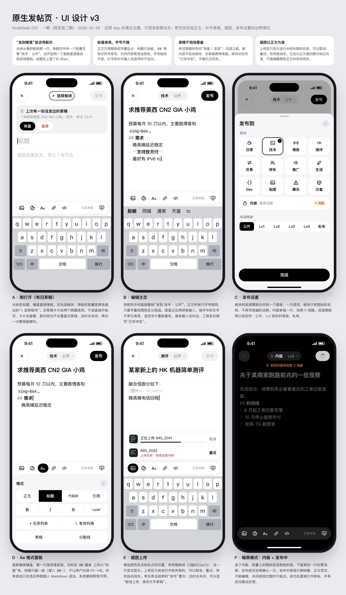

# 原生发帖页设计

## 目标

把目前加载 `/new-discussion` 网页的 `NewDiscussionWebViewController` 换成原生发帖页：标题、板块、阅读限制、Markdown 正文、插图、表情、草稿都在原生界面完成；提交仍在隐藏 WebView 里发请求，复用登录 Cookie 和 Cloudflare 放行状态。

## H5 发帖页实测（2026-10-28，登录态 Chrome）

截图：`docs/assets/2026-10-28-h5-new-discussion.png`

### 表单结构

| 区域 | 实际元素 | 说明 |
| --- | --- | --- |
| 标题 | `input#mde-title`，占位“请输入标题” | 没有 `maxlength`，前端只校验非空 |
| 编辑区切换 | 内容 / 预览 / 对照 | 预览用页面里的 `markdown-it` 渲染 |
| 工具栏 | 加粗、斜体、删除线、标题、无序列表、有序列表、引用、链接、图片、代码块、表格、分割线、撤销、重做、清空 | 另有“行号 / 工具栏开关 / 全屏” |
| 图床 | “NodeImage已就绪 / 点击登录NodeImage” | 站点自己集成了 NodeImage，和 App 回复插图用的是同一个服务 |
| 正文 | CodeMirror 编辑器，占位“鼓励友善发言，禁止人身攻击” | |
| 表情 | AC娘、洋葱头、小黄鸡、Fluent、App 五组 | 和详情页 `NodeSeekStickerLibrary` 对应 |
| 板块 | `select#category`，**默认空**，13 项 | 日常 daily、技术 tech、情报 info、测评 review、交易 trade、拼车 carpool、推广 promotion、生活 life、Dev dev、贴图 photo-share、曝光 expose、内版 inside、沙盒 sandbox |
| 阅读限制 | `select#rank`，默认“公开” | 公开 0、Lv1…Lv{当前用户等级}、私有 255；选项按 `__config__.user.rank` 生成 |
| 提交 | “发布帖子”按钮 | |
| 提醒 | 页面下方“重要提醒” | 敏感话题发内版；发卡站/大量出售发推广版；禁止人身攻击；违规会被惩罚或封号 |

注意：App 的 `PostListCategory` 里“推荐阅读、无意义、全部”不能发帖，发帖板块以上表 13 项为准。

### 前端提交逻辑（摘自 `assets/markdownEditor-*.js`）

- 校验：标题为空提示“标题不能为空”；板块未选提示“请选择正确的板块”。
- 选“内版”会先确认“发内板需要收取5鸡腿手续费，是否继续？”。
- 请求：`POST /api/content/new-discussion`，`Content-Type: application/json`，请求头 `csrf-token` 是前端随机生成的 16 位字符串。
- 请求体：`{ content, mode: "new-discussion", title, category, rank }`。
- 响应：`{ success, message, redirect, redirectHash }`；成功后跳到 `redirect + redirectHash`（新帖地址），失败弹 `message`。
- 前端超时：12 秒提示“请求超时”。
- 草稿：网页把 `{ title, content }` 存在浏览器本地（键为 `new-discussion`），与 App 无关。
- 同一个编辑器还支持 `edit-discussion`（`{ content, mode, title, postId, rank }`）、`new-comment`、`edit-comment`；编辑帖子从公开改私有要 10 鸡腿。为二期“编辑帖子”留好扩展点。

## 提交方案

在隐藏 WebView 里打开 `/new-discussion`，然后在页面里直接执行 `fetch("/api/content/new-discussion", …)`，不去模拟填写 CodeMirror、点击按钮。

- 项目里点赞、收藏、鸡腿、签到（`PostUpvoteAutomationScript`、`AutoCheckInAutomationScript` 等）已经是这种写法，稳定性已验证。
- 同源请求自动带登录 Cookie 和 Cloudflare 放行状态；`URLSession` 直接请求会被 Cloudflare 拦（本次 curl 直接 403）。
- 不依赖编辑器 DOM：网页编辑器改版不影响，只有接口参数变化才需要改。
- 页面加载后可从 `__config__.user.rank` 读出用户等级，生成阅读限制选项；读不到就只给“公开 / 私有”。

## 交互设计（UI v3）

UI 示意图：`docs/assets/2026-10-28-native-new-discussion-ui.png`（源文件同名 `.html`，改完用 Chrome 无头模式重新截图）。



v3 在 v2 外观上收紧：把空间还给正文，补齐草稿、插图、发布设置的边界情况。

### 设计原则

1. **“发到哪里”放进导航栏**：去掉作者行。导航栏中间一个胶囊“技术 · 公开 ⌄”，点开同一个面板选板块和阅读限制；未选板块时显示 `.label` 描边“+ 选择板块”。
2. **轻量高亮，字号不变**：正文所有行同一字号，只用字重和颜色：标题行加粗，`##` 用 `.secondaryLabel`，其他标记符号用 `.tertiaryLabel`，行内代码等宽加底色，图片行变淡。输入法组字中（`markedTextRange != nil`）不重新着色。
3. **草稿不悄悄覆盖**：见下文“草稿”。保存状态写“已存本机”。
4. **插图以正文为准**：上传区只显示进行中和失败的任务，传完就消失，不做缩略图和正文的双向同步。
5. **黑白主题，不用彩色强调色**：和 App 一致只用系统黑白灰。主按钮和选中态用 `.label` 底色 + `.systemBackground` 文字（浅色模式黑底白字，深色模式白底黑字）；光标用系统默认。彩色只用于语义：内版扣费提示用橙色，失败和“丢弃”用红色。圆角：按钮和胶囊全圆，卡片和面板 16，缩略图 8。其余颜色用系统动态色。

### 页面结构

| 区域 | 设计 | 实现要点 |
| --- | --- | --- |
| 导航栏 | 左：圆形“关闭”；中：发布设置胶囊；右：黑色胶囊“发布”（深色模式为白色） | 胶囊是 `titleView`；发布中按钮只显示转圈 |
| 内版提示 | 选内版时导航栏下一行橙色“发到内版将收取 5 鸡腿” | 胶囊图标换成橙色锁 |
| 标题 | 23pt 粗体，无边框，可多行 | 回车跳到正文 |
| 分隔线 | 标题与正文之间一条细线 | `.separator` |
| 正文 | 17pt，占位“鼓励友善发言，禁止人身攻击”（与网页一致） | `UITextView` + `textStorage` 轻量着色 |
| 上传区 | 工具条上方，仅进行中/失败任务：缩略图、文件名、进度条、取消/重试 | 成功即移除 |
| 悬浮工具条 | 图片、表情、Aa、链接、代码 ｜ 已存本机 ｜ 收起键盘 | `inputAccessoryView` |

### 各状态（对应示意图 A–F）

- **A 刚打开（有旧草稿）**：光标在标题；顶部草稿卡“恢复 / 丢弃”。
- **B 编辑主态**：拼音组字中不着色，选字后再着色。
- **C 发布设置**：半屏 sheet，“板块”4 列图标网格（只有图标和名称）+ 内版单独一行标“5 鸡腿”，“阅读限制”分段控件（公开、Lv1…当前等级、私有），底部“完成”。等级读取失败时显示“读取失败 · 重试”，不悄悄改成公开；草稿里存的受限等级原样保留。
- **D Aa 格式面板**：替换键盘。段落类型（正文 / 标题 / 代码块 / 引用），标题只提供一级（`## `）；B / I / S / 行内代码；无序 / 有序列表；表格 / 分割线。
- **E 插图上传**：先在光标处插入占位，传完替换为 ``；有任务时“发布”置灰；此时关闭可选“取消上传，保存文字草稿”。
- **F 发布中（暗黑模式 + 内版）**：正文变淡不可编辑，关闭不可点。

表情面板沿用详情页的 `NodeSeekStickerPickerView`，交互同 Aa 面板。

### 草稿（单份，已确认）

- 正常情况：停止输入 1 秒自动存本机，发布成功后清除。
- 打开时有旧草稿：显示“恢复 / 丢弃”。**没选之前不自动保存新内容**，旧草稿保持不变。
- 没选就点关闭：如果写了新内容，操作表“保存新内容（替换旧草稿）/ 保留旧草稿 / 继续编辑”。
- 不做草稿箱和入口提醒；和网页端草稿互不相通。

### 弹窗与反馈

- 内版确认：“发内版需要收取 5 鸡腿手续费，是否继续？”，按钮“取消 / 继续”（和网页一致）。
- 有内容时关闭：系统操作表“保存草稿并关闭 / 放弃草稿 / 继续编辑”。
- 发布失败：标题“发布失败”，内容为服务端 `message`，按钮“重试 / 用网页发帖 / 取消”。
- 超时：标题“发布结果未知”，内容“可能已经发出，请先到‘我的帖子’确认，再决定是否重试”。
- 成功：成功震动 → 关闭发帖页 → 打开新帖详情。

### 待确认

- 一期实现前先做一个编辑器原型，在真机上验证中文输入、撤销重做、长文粘贴、键盘与面板切换。

### 发布流程

1. 打开页面 → 检查登录（未登录弹登录，和详情页回复一致）→ 后台预热隐藏 WebView 加载 `/new-discussion`，顺便读用户等级。
2. 输入时停顿 1 秒自动保存草稿（标题、板块、阅读限制、正文）。
3. 点“发布” → 本地校验（标题非空、板块已选、正文非空）→ 内版确认 → 按钮转圈，锁定输入。
4. 隐藏 WebView 执行脚本发请求，超时 15 秒。
5. `success = true`：清草稿 → 关闭发帖页 → 从 `redirect` 解析新帖 ID 并打开详情页（解析失败就刷新列表）→ Toast“发布成功”。
6. `success = false`：保留内容，弹服务端 `message`。
7. 超时或网络错误：不自动重试，提示“可能已经发出，请到‘我的帖子’确认后再重试”，避免重复发帖。
8. 兜底：错误弹窗里提供“用网页发帖”，打开原 `NewDiscussionWebViewController`，同时把正文复制到剪贴板。

## Markdown 方案

分两件事：一期的“编辑时高亮”，和二期的“预览渲染”。参考 PerchBoard iOS（`/Volumes/meta/Devv/PerchBoard/iOS`）的已有做法。

### 一期：编辑时高亮（不引入新依赖）

做法照搬 PerchBoard `TaskCreateViewController.styleText`：普通 `UITextView`，每次文字变化后在 `textStorage` 上 `beginEditing` → 重设属性 → `endEditing`，**只改字体和颜色，不动文字和选区**，最后同步 `typingAttributes`。

- 纯逻辑放 `SharedCore/Composer/MarkdownEditorHighlighter.swift`：输入纯文本，输出 `[(NSRange, 样式种类)]`，不依赖 UIKit，SwiftPM 可测。
- 只认帖子里常用的语法，逐行扫描：
  - 块级：`#`～`######` 标题、`-`/`*`/`1.` 列表、`>` 引用、```` ``` ```` 代码块（跨行状态）、`---` 分割线、表格行。
  - 行内：`**粗体**`、`*斜体*`、`~~删除线~~`、`` `代码` ``、`[链接](url)`、``、表情标记。
- UI 层（`Features/NewDiscussion`）把样式种类映射为字体/颜色：标记符号用 `.tertiaryLabel`，标题加大加粗，代码用等宽字体 + `.secondarySystemFill` 底色，图片行整行变淡。
- 性能：帖子正文通常几 KB，整段重算即可；超过约 2 万字时只重算光标附近段落（PerchBoard 也是整段重算，先不过度设计）。
- 不用 swift-markdown 做编辑高亮：它面向完整文档解析，输入到一半的语法（比如只打了一个 `**`）会频繁变来变去，而且要给 App 和 SwiftPM 都新增依赖；正则逐行扫描更稳定，也更好测。

### 二期：预览渲染

两个选项：

| 方案 | 做法 | 优点 | 缺点 |
| --- | --- | --- | --- |
| A（建议） | swift-markdown 0.7.3 解析 → 自带的 `HTMLFormatter` 转 HTML → 交给详情页现有的 DTCoreText 富文本渲染 | 预览和帖子发出后在详情页的样子一致；只多一个苹果官方的包 | 和网页 markdown-it 的细节可能有差异（如自动链接、换行规则），需要用样例对比 |
| B | 引入 PerchBoard 的 SwiftStreamingMarkdown UIKit 分支（`MarkdownUIView`） | 原生视图，代码块高亮、表格、图片都现成 | 外观和详情页不一致；还会带进 HighlightSwift、iosMath 两个依赖，体积大 |

预览要回答的问题是“发出去长什么样”，所以选 A；PerchBoard 的分支更适合它自己的流式对话场景。可以借用的是它的图片处理思路（`imageViewProvider`：加载、失败重试、点开预览由宿主控制）。

### 图片和关闭确认

- 图片选择沿用 PerchBoard `TaskCreateViewController` 的流程：`PHPickerViewController` 多选、按顺序逐张上传，上传中（`isUploadingImage`）禁止发布和关闭。
- 关闭确认同样参考它的 `presentationControllerDidAttemptToDismiss` + 操作表；我们多一个“保存草稿并关闭”。

## 文件规划

| 层 | 文件 | 职责 |
| --- | --- | --- |
| SharedCore/Domain | `DiscussionCategory.swift`（新增） | 13 个可发帖板块（rawValue 即表单值）、阅读限制选项按等级生成 |
| SharedCore/Composer | `NewDiscussionDraft.swift`（新增） | 草稿模型（Codable）、提交前校验、请求体构造 |
| SharedCore/Composer | `MarkdownSnippetInserter.swift`（新增） | 工具栏动作：输入文本+选区，输出新文本+新选区 |
| SharedCore/Composer | `MarkdownEditorHighlighter.swift`（新增） | 编辑时高亮：纯文本 → 样式区间，SwiftPM 可测 |
| SharedCore/Parsing | `NewDiscussionResponseParser.swift`（新增） | 解析 `{success,message,redirect,redirectHash}`，从 redirect 取帖子 ID |
| AppRuntime/Web/AutomationScripts | `NewDiscussionSubmissionAutomationScript.swift`（新增） | 页面内 fetch 发帖、读用户等级，返回结果和 diagnostics |
| AppRuntime/Web | `HiddenWebViewCommentSubmissionClient.swift`（修改） | 增加 `HiddenWebViewDiscussionSubmissionClient`，复用 `withPostActionHiddenWebViewLoader` |
| AppRuntime/Web | `NodeSeekDiscussionSubmitter.swift`（新增） | 对标 `NodeSeekCommentSubmitter`：错误映射为中文 |
| AppRuntime/Services | `NewDiscussionDraftStore.swift`（新增） | 草稿持久化（单份） |
| Features/NewDiscussion | Contract / Presenter / Interactor / Router / ViewController（新增） | 原生发帖页 |
| Features/PostDetail/NodeImage（修改，单独提交） | 抽出 `NodeImageInsertionCoordinator` | 图片选择、授权、上传从 `PostDetailViewController` 扩展里抽出，回复和发帖共用 |
| Features/PostList | `PostListRouter.swift`（修改） | `navigateToNewDiscussion` 改为弹出原生页；保留网页版作兜底 |

## 风险

1. **接口是前端私有接口**，参数可能变。脚本把 HTTP 状态和响应体放进 diagnostics，出错时日志能直接看出原因；同时保留网页兜底。
2. **`csrf-token` 目前是前端随机值**，服务端如果以后改成校验真实 token，脚本改为从页面读取即可，原生层不受影响。
3. **重复发帖**：超时不自动重试（见流程第 7 步）。
4. **本次没有真实发帖**，只读了页面和脚本。实现后用“沙盒”板块 + “私有”阅读限制真发一帖验证。

## 分期

- 一期：板块、阅读限制、标题、正文、工具栏（图片、表情、常用 Markdown）、隐藏 WebView 提交、草稿、内版确认、失败兜底、成功后打开新帖。
- 二期：预览、编辑帖子（`edit-discussion`，阅读限制改私有的 10 鸡腿确认）、编辑评论。

## 测试

- SwiftPM：板块/阅读限制选项、草稿校验与请求体、Markdown 插入的选区变换、编辑高亮区间（含代码块跨行、半截语法）、响应解析与帖子 ID 提取。
- Xcode 窄测：`NodeSeekDiscussionSubmitter`（mock 隐藏 WebView 结果 → 错误文案）、Presenter（校验失败、提交中锁定、成功清草稿、超时提示）、Router（入口改为原生页）。
- 手动：真机在沙盒板块、私有阅读限制下发一帖；再测未登录、断网、超时、板块未选。

## 验证命令

- `make spm-test`
- `make xcode-test-class TEST=NodeSeekDiscussionSubmitterTests`（以及 Presenter/Router 测试）
- 跨层改动完成后 `make xcode-build-tests`
