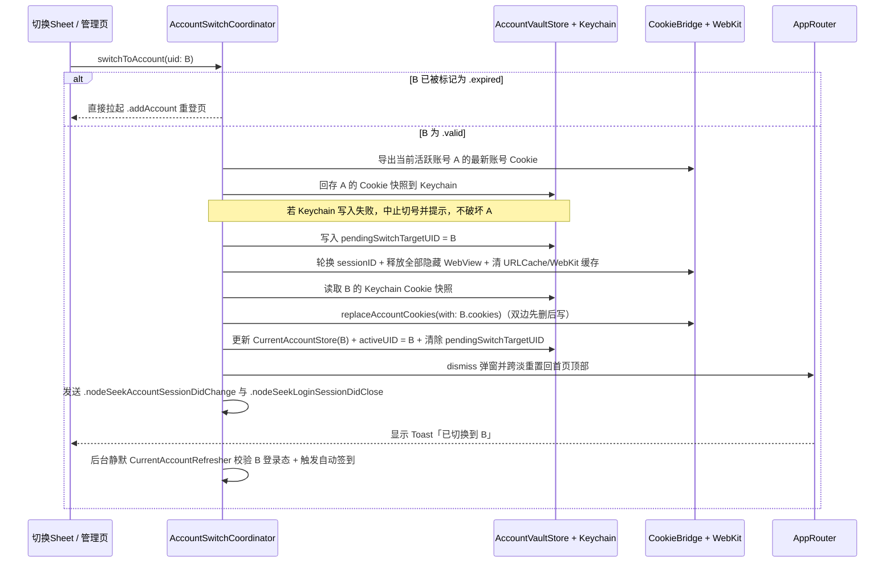

# 多账号切换与管理技术设计

日期：2026-11-25（已根据代码审核修订）

## 1. 目标与范围

在 NodeSeek iOS 客户端内支持本地保存多个 NodeSeek 账号、快速切换账号会话、管理已保存账号，并在开启自动签到时按顺序为所有有效账号依次签到。

### 1.1 本期实现（In Scope）

- **账号切换与管理**：支持添加多个账号、一键切换、删除单个账号、失效账号重新登录、退出当前账号切回游客模式。
- **双导航布局入口**：同时覆盖多 Tab 模式（「我的」页资料卡）和侧边栏模式（账号头）快捷切换，以及设置页「账号管理」入口。
- **切号后统一重置首页**：切换或退出完成后，先 dismiss 弹出页面，再跨淡重建根界面回到首页顶部，避免旧账号二级页面或私密内容残留。
- **老版本无感升级**：兼容现有单账号存储，升级后不掉登录、不丢 NodeImage Key 和未发布发帖草稿。
- **多账号依次自动签到**：开启自动签到后，在不污染当前活跃会话的前提下，串行为本地所有有效且今日未签到的账号依次签到。
- **会话过期闭环**：区分网络错误/Cloudflare 过盾与真实 Cookie 失效，标记失效状态（保留快照不误删）并支持一键重登或切回原账号。
- **发帖身份防误发**：保持全局一份发帖草稿，但在发帖页明确提示当前发布身份（「将以 `<昵称>` 身份发布」）。
- **推送 UID 字段预留**：在 `PushNotificationRoute` 预留可选接收者 UID 字段解析（仅解析留口子，暂不自动切号）。

### 1.2 本期不做（Out of Scope）

- 多账号后台轮询未读通知/私信聚合。
- 推送点击触发自动切号（当前 `ns-apns` 未下发接收账号 UID，待有真实数据后再按统一重置流程接入）。
- 按 UID 隔离发帖草稿（保持全局一份，通过身份提示防错发）。
- 跨设备 iCloud 同步账号 Cookie（高敏感会话凭证，仅存本机 Keychain）。
- “保留当前账号凭证、临时切回游客态”的独立模式（退出即删除当前号本地快照并进入游客态）。

---

## 2. 实测验证结果（2026-11-25）

已基于本机已登录测试会话（只读提取元数据，未泄露凭证值）完成隔离性实测：

1. **真实 Cookie 名单（`nodeseek.com` 域）**：
   - **账号登录凭证（30 天同步过期）**：`session`（`www.nodeseek.com`, `HttpOnly`）、`pjwt`（`www.nodeseek.com`）、`smac`（`www.nodeseek.com`）。
   - **Cloudflare 过盾与站点偏好**：`cf_clearance`（`.nodeseek.com`, `Secure`, `HttpOnly`, 1 年）、`colorscheme`（`www.nodeseek.com` & `.nodeseek.com`）、`sortBy`（`www.nodeseek.com`）、`hmti_`（`www.nodeseek.com`, 1 年）。
2. **`localStorage` 检查（origin: `https://www.nodeseek.com`）**：
   - 发现存有 `security_token`、`csrf_token`、`lastCarouselTopicId`。
   - **实测结论**：仅携带 `cf_clearance + session + pjwt + smac`（不带 `localStorage`）请求 `/api/notification/unread-count` 返回 `200 {"success":true,...}`；去掉 `session/pjwt/smac` 仅保留 `cf_clearance` 返回未登录 `{"message":"USER NOT FOUND","status":404,"success":false}` 且未触发盾。
   - **架构影响**：登录态完全由 Cookie 决定，切号可安全保留 `cf_clearance` 免重过盾；同时切号与退登时需一并清理 `WKWebsiteDataTypeLocalStorage` 与 `WKWebsiteDataTypeSessionStorage`，避免旧账号的 `security_token` / `csrf_token` 残留给新账号。
3. **同设备多会话并存**：待阶段 3 自动签名包实测时，通过 `AddAccountWebViewController` 用同一测试账号独立登录 1 次核验旧 session 有效性（不调用服务端 signOut）。

---

## 3. 现有架构约束与核查结论

以下结论基于当前代码基线核查：

1. **最低系统版本为 iOS 15.0**：主 App `IPHONEOS_DEPLOYMENT_TARGET = 15.0`（仅 `ProbeWidget` 为 17.0），不能将 iOS 17+ 的 `WKWebsiteDataStore(forIdentifier:)` 作为主方案，采用 **Keychain Cookie 快照 + 活跃存储双边替换** 方案。
2. **双存储只增不删**：`CookieBridge` 的 `syncWebViewCookiesToURLSession` 与 `syncURLSessionCookiesToWebView` 都是只 `setCookie` 不 `deleteCookie`；且 `BaseWebViewController` 默认通过 `NodeSeekWebViewContext` 在加载前把全局 URLSession Cookie 注入 WebView、关闭时再回写全局存储。
3. **两类会话通知并存**：`MainTabBarController` 监听 `.nodeSeekAccountSessionDidChange`，而 `NodeSeekVoteService`、`NodeSeekVoteAPIClient`、`VoteViewModel`、`PostListSideMenuAccountController` 只监听 `.nodeSeekLoginSessionDidClose`。切号与退登必须**同时发送两个通知**。
4. **常驻隐藏 WebView 分布多处**：除 `HiddenWebViewPostActionPageScheduler` 外，还有 `HiddenWebViewPageActionScheduler`、`HiddenWebViewLoader.shared` / `isolatedLoaders`（会通过 `reusesLoadedPage: true` 复用已加载页面）以及 `HiddenWebViewPreloadLoader.shared`；WebKit 自身也有 `DiskCache` / `MemoryCache`。
5. **稳定主键与写保护已存在**：`AccountResponse.nodeSeekUID` 从 `profileURL`（`/space/<uid>`）解析；`CurrentAccountStore` 已有 `sessionID: UUID?` 防旧请求回写；`AppRouter.applyCurrentLayout()` 已有先 dismiss 再跨淡重建根界面的实现。
6. **推送现状**：`PushNotificationRoute` 当前仅解析 `type`、`post_id`、`floor`、`url`，尚无接收者 UID 字段。

---

## 4. 数据归属与隔离边界

| 模块 / 数据 | 现有存储位置 | 多账号归属 | 处理策略 |
| --- | --- | --- | --- |
| 活跃登录态 Cookie | `WKWebsiteDataStore.default()` + `HTTPCookieStorage.shared` | **当前活跃账号（唯一真源）** | 活跃账号以活跃存储为准；切换时双边先删后写，保留 CF/主题 Cookie |
| 已保存账号 Cookie 快照 | 新增 Keychain (`com.nodeseek.account-cookies`) | **按 UID 隔离（非活跃持久化 / 活跃备份）** | 每账号独立条目（`uid-<uid>`），退出/删除账号时移除；重装首启清孤儿条目 |
| 账号元数据列表 | 新增 UserDefaults (`com.nodeseek.account-vault`) | **多账号集合** | 存 UID、昵称、头像、主页 URL、统计、最近使用时间、凭证状态 |
| 当前账号快照缓存 | `CurrentAccountStore` (`com.nodeseek.current-account`) | **当前活跃账号** | 保持 key 与编码格式向后兼容 |
| 自动签到每日状态 | `AutoCheckInStateStore` (`autoCheckIn.statesByUID`) | **按 UID 隔离** | 新 key 按 `uid` 存每日完成态；不做旧单账号迁移（签到前会先查站点榜单，无重复签风险） |
| NodeImage 图床 Key | Keychain (`com.nodeseek.nodeimage / api-key`) | **全局共用** | 切换账号与退出登录均**不清空**，仅在图床设置中手动清除 |
| 发帖草稿 | `UserDefaultsNewDiscussionDraftStore` | **全局共用** | 保持全局一份，发帖页明确提示「将以 `<昵称>` 身份发布」 |
| 浏览记录 / 搜索历史 / 特别关注词 | SQLite / UserDefaults | **设备级共享** | 保持现状，不随切号清空 |
| 阅读/分类/排序/字号/导航布局/自动签到开关 | UserDefaults | **设备级共享** | 保持现状 |
| 探针（Probe）/ 邮箱（SeekMail） | 独立凭证存储 | **设备级共享** | 与 NodeSeek 会话无直接耦合 |
| 系统推送（APNs Token） | `PushNotificationTokenStore` | **设备级 + UID 预留** | 本期仅在 `PushNotificationRoute` 预留可选 UID 解析，不自动切号 |

---

## 5. 系统架构与独立模块化目录设计

遵循 `docs/project-overview.md` 的 SwiftPM 测试边界，同时参照项目现有的 `AutoCheckIn` / `Mail` / `Probe` / `HotList` 模块化惯例，将多账号代码**高度收拢到两个独立目录**，通过唯一门面 `AccountsModule` 对外提供能力，把对既有业务代码的侵入降到最低：

- **`nodeseek/SharedCore/Accounts/`**：无 UIKit / WebKit 依赖的纯逻辑（`Package.swift` 自动纳入 `NodeSeekCore`，直接跑 `make spm-test`）；
- **`nodeseek/Features/Accounts/`**：多账号完整运行时与界面（门面、Keychain 存储、切号协调器、独立添加账号 WebView、切换 Sheet、账号管理页、本地化）；
- **既有模块仅做极薄接入钩子**：通过 `AccountsModule` 调用，不把多账号内部实现散落到 `AppRuntime` 或其他 Feature。

```text
nodeseek/
├── SharedCore/
│   ├── Accounts/                             # [新增 · 独立纯逻辑目录] SwiftPM 直接可测
│   │   ├── AccountVaultModels.swift          # SavedAccount、AccountCredentialState
│   │   ├── AccountVaultStore.swift           # 多账号元数据仓库（UserDefaults 注入）
│   │   └── NodeSeekCookieClassifier.swift    # 区分账号会话 Cookie 与 Cloudflare/主题保留 Cookie
│   └── Domain/
│       ├── CurrentAccountStore.swift         # [小改] 支持切换轮换 sessionID、返回校验后的写入结果
│       └── PushNotificationRoute.swift       # [小改] 预留可选 targetAccountUID 解析
├── Features/
│   ├── Accounts/                             # [新增 · 独立功能模块目录] 运行时 + Keychain + UI 全收拢
│   │   ├── AccountsModule.swift              # 唯一对外门面（供入口、启动、退出、自动签到调用）
│   │   ├── AccountCookieVault.swift          # Keychain 按 UID 读写与重装孤儿清理
│   │   ├── AccountSwitchCoordinator.swift    # 串行编排采纳、切换、添加、退登、中断恢复、过期闭环
│   │   ├── AddAccountWebViewController.swift # 独立 nonPersistent() 添加账号页（不侵入原 LoginWebViewController）
│   │   ├── AccountSwitcherViewController.swift     # 快捷切换半屏 Sheet
│   │   ├── AccountManagementViewController.swift   # 设置页「账号管理」二级页
│   │   ├── AccountRowCell.swift                    # 复用的账号列表行（暗黑 + 动态字号）
│   │   └── AccountsL10n.swift                      # 模块本地化 helper
│   ├── AutoCheckIn/                          # [小改] 接入 AccountsModule 获取多账号快照与依次签到
│   │   ├── AutoCheckInStateStore.swift       # 按 UID 记录今日完成状态
│   │   ├── AutoCheckInSettingsStore.swift    # 新增「为全部已保存账号依次签到」配置（默认开）
│   │   ├── AutoCheckInSettingsViewController.swift # 始终显示「为全部已保存账号依次签到」开关
│   │   ├── WebViewAutoCheckInAutomator.swift # 独立 nonPersistent() WebView 签到（设 UA + 回写续期 Cookie）
│   │   └── AutoCheckInCoordinator.swift      # sessionID 校验、依次签到与汇总 Toast
│   ├── Layout/
│   │   └── MainTabBarController.swift        # [小改] 避免与 AppRouter 整体重建根界面时双重重建 Tab
│   ├── NewDiscussion/
│   │   └── NewDiscussionViewController.swift # [小改] 展示当前发布账号身份提示
│   ├── Me/
│   │   └── MeViewController.swift            # [小改] 资料卡增加账号切换快捷入口（调 AccountsModule）
│   ├── SideMenu/
│   │   └── PostListSideMenuViewController.swift # [小改] 账号头增加账号切换快捷入口（调 AccountsModule）
│   └── Settings/
│       ├── SettingsManagers.swift            # [小改] logout 委托 AccountsModule，移除清空 NodeImage Key；复用 WebView 缓存清理
│       └── SettingsViewController.swift      # [小改] 账号区新增「账号管理」行（调 AccountsModule）
├── AppRuntime/                               # 仅暴露必要的底层基础设施原语，不含多账号业务逻辑
│   ├── Web/
│   │   ├── CookieBridge.swift                # [小改] 提供双边先删后写 replaceAccountCookies、导出账号/CF Cookie
│   │   ├── NodeSeekCookieSession.swift       # [小改] 透传底层 Cookie 快照原语
│   │   ├── HTMLClient/
│   │   │   └── HiddenWebViewHTMLClient.swift # [小改] 提供 invalidateAllSessions() 全量释放隐藏 WebView
│   │   ├── HiddenWebViewCommentSubmissionClient.swift # [小改] 联动释放 PostAction 与 PageAction 通道
│   │   └── WebViewControllers/
│   │       └── LoginWebViewController.swift  # [小改] 游客登录成功后回调 AccountsModule 采纳
│   └── Services/
│       ├── CurrentAccountRefresher.swift     # [小改] 刷新结果回调 AccountsModule 采纳或标记失效
│       └── NodeSeekService.swift             # [小改] saveOpportunisticAccount 经 sessionID 校验通过后回调 AccountsModule
└── App/
    ├── AppDelegate.swift                     # [小改] 冷启动调用 AccountsModule 清理重装孤儿 + 恢复中断切换
    └── AppRouter.swift                       # [小改] 提供 resetToHomeForAccountChange(completion:)
```

> 配套单测同样按目录对齐：`nodeseekTests/SharedCore/Accounts/`（SwiftPM 快速测试）与 `nodeseekTests/Features/Accounts/`（Xcode App-hosted 测试）。

---

## 6. 核心模块详细设计

### 6.1 账号元数据模型与单一真源约束

```swift
nonisolated enum AccountCredentialState: String, Codable, Equatable, Sendable {
    case valid
    case expired
}

nonisolated struct SavedAccount: Codable, Equatable, Sendable {
    let uid: Int
    var displayName: String
    var avatarURL: URL?
    var profileURL: URL
    var stats: [String]
    var lastUsedAt: Date
    var credentialState: AccountCredentialState
}
```

- **单一真源原则**：
  - **活跃账号**：以活跃存储（`WKWebsiteDataStore.default().httpCookieStore` + `HTTPCookieStorage.shared`）中的 Cookie 为唯一真源；Keychain 中的对应条目仅作为备份，切号前或刷新成功后单向同步覆盖。
  - **非活跃账号**：以 Keychain 中的 Cookie 快照为唯一持久化来源。
- **主键与排序**：仅当 `AccountResponse.isLoggedIn == true` 且能从 `profileURL` 解析出合法 `nodeSeekUID: Int` 时入库；`upsert` 按 `uid` 去重合并；展示时当前 `activeUID` 置顶，其余按 `lastUsedAt` 降序。
- **中断恢复标记**：持久化 `pendingSwitchTargetUID: Int?`（key：`com.nodeseek.account-vault.pending-switch`），用于切号途中进程被强杀时的冷启动补全。

### 6.2 Cookie 分类、双边替换与 Keychain 存储

#### Cookie 分类规则（`NodeSeekCookieClassifier`）
对匹配 `NodeSeekSite.allowedCookieDomains`（`nodeseek.com` 及子域）的 `HTTPCookie` 进行分类（待开工前实测名单微调）：

- **保留类（`preserved`）**：切号与退登均不删除、不写入账号快照：
  - Cloudflare 过盾及会话保护：`cf_clearance`、`__cf_bm`、前缀 `cf_chl_`、`_cfuvid`、`__cflb`（大小写不敏感）
  - 站点外观与设备偏好：`colorscheme`（`NodeSeekWebThemeSupport.colorSchemeCookieName`）、`sortBy`、`hmti_`
- **账号会话类（`accountSession`）**：其余属于 `nodeseek.com` 域（含 `www.nodeseek.com`、`.nodeseek.com` 等所有子域）的全部 Cookie（已实测覆盖 `session`、`pjwt`、`smac`）。

#### 双边先删后写（`CookieBridge.replaceAccountCookies`）
由于现有 `CookieBridge` 双向同步只增不删，任何一边残留旧账号 Cookie 都会在下次同步时“复活”并导致两账号 Cookie 混用。因此 `replaceAccountCookies(with targetCookies:)` 必须严格按两阶段执行：

1. **阶段 1（双边全清账号 Cookie）**：
   - 遍历 `HTTPCookieStorage.shared.cookies` 中所有 `isAllowed && isAccountSession` 的 Cookie，逐个 `deleteCookie`；
   - 遍历 `WKHTTPCookieStore.allCookies()` 中所有 `isAllowed && isAccountSession` 的 Cookie，逐个 `await deleteCookie`（精确按 Cookie 对象自身的 `name`、`domain`、`path` 删除，覆盖 `.nodeseek.com`、`nodeseek.com`、`www.nodeseek.com`）；
   - 校验两边的剩余 Cookie 中不再含任何账号类 Cookie。
2. **阶段 2（双边写入目标 Cookie）**：
   - 将 `targetCookies` 同时写入 `HTTPCookieStorage.shared` 与 `WKHTTPCookieStore`。

#### Keychain 存储（`AccountCookieVault`）
- Keychain 属性：`kSecClassGenericPassword`、`kSecAttrService = "com.nodeseek.account-cookies"`、`kSecAttrAccount = "uid-\(uid)"`、`kSecAttrAccessible = kSecAttrAccessibleAfterFirstUnlockThisDeviceOnly`。
- 序列化：将 `HTTPCookie` 转为 `Codable` 的 `PersistedCookie`（`name`、`value`、`domain`、`path`、`expiresDate`、`isSecure`、`isHTTPOnly`、`version`、`sameSitePolicy`、`comment`），JSON 编码后写入。过滤已过期条目时保留会话级 Cookie（`expiresDate == nil`）。
- **重装孤儿清理**：删除 App 后 UserDefaults 会清空而 Keychain 会残留。首次启动在**老账号采纳之前**，若 `AccountVaultStore` 为空（尚未初始化），先调用 `AccountCookieVault.deleteAll()` 清空 `com.nodeseek.account-cookies` 下所有历史残留条目。该操作仅清理多账号专用 service，不影响旧版活跃 Cookie 和 NodeImage Key。

### 6.3 切号时必须失效的状态与通知全清单

切号（A → B）与退出登录时，必须统一执行以下完整清理，避免旧账号状态残留：

1. **轮换 `CurrentAccountStore.sessionID`**：拦截所有切号前发出的在途 HTTP/HTML 请求回写（切号不阻塞等待进行中的自动签到，由签到写状态前顺手核对 `sessionID` 兜底即可）。
2. **释放所有常驻隐藏 WebView**：
   - `HiddenWebViewPostActionPageScheduler.invalidatePreparedPage()`
   - `HiddenWebViewPageActionScheduler.invalidatePreparedPage()`
   - `HiddenWebViewLoader.invalidateAllSessions()`（释放 `shared` 与所有 `isolatedLoaders` 中通过 `reusesLoadedPage: true` 复用的页面）
   - `HiddenWebViewPreloadLoader.shared.cancelAndReset()`（中止并丢弃首页预载）
3. **清理网络与 WebKit 页面缓存及站点存储（保留 Cookie）**：
   - `URLCache.shared.removeAllCachedResponses()`
   - 清理 `WKWebsiteDataTypeDiskCache`、`WKWebsiteDataTypeMemoryCache`、`WKWebsiteDataTypeLocalStorage`、`WKWebsiteDataTypeSessionStorage`（清掉旧账号残留的 `security_token` / `csrf_token` 等 `localStorage` 项，保留 Cookie）。
4. **同时发送两个会话变更通知**：
   - 发送 `.nodeSeekAccountSessionDidChange` 与 `.nodeSeekLoginSessionDidClose`（确保只监听后者的 `NodeSeekVoteService`、`NodeSeekVoteAPIClient`、`VoteViewModel`、`PostListSideMenuAccountController` 等全部清空旧账号状态）。
5. **避免根视图与 Tab 双重重建**：
   - `AppRouter.resetToHomeForAccountChange(completion:)` 先 `dismiss` 已弹出的 Sheet/页面，再跨淡替换 `window.rootViewController` 回到首页顶部；
   - `AccountSwitchCoordinator` 先触发 `AppRouter` 替换根界面（旧 `MainTabBarController` 随即释放），再发送会话变更通知（或为整根替换的会话通知打标记，使旧 `MainTabBarController` 跳过无意义的 Tab 重建）。

### 6.4 核心流程状态机（`AccountSwitchCoordinator`）

`AccountSwitchCoordinator` 为 `@MainActor` 协调器，内部维护串行互斥状态 `isTransitioning`，所有账号变更均经由它串行执行。

#### 流程 A：切换账号（A → B）



#### 流程 B：添加账号（独立 `AddAccountWebViewController` 隔离登录）

为避免默认 `NodeSeekWebViewContext` 把全局 A 的 Cookie 同步进登录页、或在关闭时回写全局存储，同时不侵入原有 `LoginWebViewController`（降低游客登录回归风险），在 `Features/Accounts/` 下单独实现 `AddAccountWebViewController`，**完全绕过 `NodeSeekCookieSession`**：

1. 创建独立的 `WKWebViewConfiguration`，指定 `websiteDataStore = .nonPersistent()`，并设置 `webView.customUserAgent = WebRequestFingerprint.userAgent`。
2. 初始加载前，**不调用** `syncURLSessionCookiesToWebView()`，仅向该临时 `WKHTTPCookieStore` 写入 `exportCloudflareCookies()` 与 `colorscheme` Cookie。
3. 登录检测与关闭规则：
   - 页面自动检测到 `account.isLoggedIn && account.profileURL != nil` → 视为登录成功；
   - 用户点击右上角「关闭」→ 仍按现有兜底读一次当前页 HTML：若已解析出有效登录账号则视为添加成功（防止刚登完顺手点关闭白登），否则视为取消，直接销毁临时 WebView，**对当前活跃账号零影响**。
4. 登录成功后，**不调用** `captureWebViewSession()`、**不直接写** `CurrentAccountStore`、**不直接发** `.nodeSeekLoginSessionDidClose`，而是从临时 `WKHTTPCookieStore` 提取全部账号类 Cookie 交给 `AccountSwitchCoordinator.completeAddAccount(account:cookies:)`：
   - 回存当前活跃账号（若有）的最新 Cookie 到 Keychain；
   - 将新账号 Cookie 存入 Keychain、`AccountVaultStore.upsert`（同 UID 去重覆盖并置 `.valid`）；
   - 执行标准切换清理与双边 Cookie 替换、重置回首页顶部并发送双通知。

#### 流程 C：退出登录与删除账号

- **删除非当前活跃账号**：二次确认 → 删除该 UID 的 Keychain 快照和 `AccountVaultStore` 记录 → 仅刷新管理页列表，不重置首页。
- **退出当前账号**（设置页「退出登录」或管理页删除当前活跃账号）：
  1. 二次确认弹窗，说明将退出当前账号并移除本地保存的登录凭证；
  2. 删除当前 UID 的 Keychain 快照与 `AccountVaultStore` 记录，`activeUID = nil`；
  3. 执行标准清理（轮换 `sessionID`、双边清空账号类 Cookie 且保留 Cloudflare/主题 Cookie、释放隐藏 WebView 与页面缓存）；**不清空 NodeImage Key**；
  4. 清空 `CurrentAccountStore` 进入游客态；
  5. `AppRouter.resetToHomeForAccountChange()` 跨淡回到首页顶部，并发送两个会话变更通知；
  6. **切号引导提示**：
     - 若仓库仍有其他已保存账号：在首页展示提示「已退出登录，当前为游客模式。可切换到其他已保存账号」，提供 **「切换账号」**（拉起 `AccountSwitcherViewController`）与 **「暂不」**；
     - 若无其他账号：展示普通 Toast「已退出登录」。

#### 流程 D：采纳逻辑的 UID 绑定硬约束（防迟到响应串号）

`adoptCurrentSessionIfNeeded(account:requestSessionID:)` 必须满足以下**全部条件**才允许将活跃 Cookie 写入 Keychain：

1. 只能在 `CurrentAccountStore.save(account, for: requestSessionID)` 返回 `true` 之后触发（即必须经过 `sessionID` 校验，拦截所有切号前的迟到响应）；
2. 当前 `AccountSwitchCoordinator.isTransitioning == false`；
3. `requestSessionID` 仍等于当前 `CurrentAccountStore.sessionID`；
4. `account.nodeSeekUID == AccountVaultStore.activeUID`（仅当仓库为空、老版本首次采纳时允许 `activeUID == nil`）；
5. 任一条件不满足直接拒绝写入并记录 debug 日志，杜绝将 B 的活跃 Cookie 错写到 A 的 Keychain 条目。

#### 流程 E：会话过期判定与安全处理（不误删快照）

- **严格判定条件**：
  - 网络错误、超时、HTTP 5xx、或命中 `ChallengeDetector`：**绝不标记过期**；
  - 仅在主页或账号校验接口返回正常 200 HTML（非 challenge、非维护/错误页），且确认存在登录入口/游客态（`isLoggedIn == false`）时，才标记对应账号为 `credentialState = .expired`。
- **保留快照原则（防误判不可逆）**：
  - 标记 `.expired` 时**保留该账号的 Keychain 快照，不主动清空活跃 Cookie**，避免因站点偶发改版或异常页面误判导致凭证永久丢失；
  - 仅在用户主动重新登录（覆盖旧快照）或主动删除/退出账号时才修改或删除 Keychain 条目。
- **各场景交互闭环**：
  - **当前活跃账号被标 `.expired`**：UI 提示「账号 `<name>` 登录可能已失效」，提供 **「重新登录」**（拉起 `.addAccount` 重登覆盖）与 **「切换账号」**（若有其他已保存号）；
  - **切到 B 后后台校验标 `.expired`**：记住切号前 `previousUID`，弹窗提示「`<B>` 登录可能已失效」，提供 **「重新登录」** 与 **「切回 `<A>`」**；
  - **点击列表里已标 `.expired` 的账号**：直接打开 `.addAccount` 重登，登完覆盖凭证并切过去；
  - **后台依次签到发现非当前号过期**：不打断当前页面，静默标 `.expired` 并跳过继续下一个账号。

---

### 6.5 老版本无感升级与切号中断恢复

1. **老版本升级 0 掉登**：
   - 保持 `WKWebsiteDataStore.default()`、`HTTPCookieStorage.shared`、`com.nodeseek.current-account`、NodeImage Key、发帖草稿原样不动；
   - 启动顺序：先完成 `AppDelegate.logoutCleanup`（若存在未完退登标记）→ 若 `AccountVaultStore` 为空先清孤儿 Keychain（仅清 `com.nodeseek.account-cookies`）→ 再触发老账号只读采纳（有缓存且有 UID 立即收编；无缓存则静默等待首屏页面通过 `saveOpportunisticAccount` 收编）。
2. **切号中断恢复**：
   - 冷启动检测到 `pendingSwitchTargetUID = B` 非空时（在建立窗口前，与 `logoutCleanup` 同阶段）：若 Keychain 存在 B 的快照，补跑一次双边 `replaceAccountCookies(with: B.cookies)` 并同步 `CurrentAccountStore`，再清掉标记；否则直接清掉标记交由首屏刷新纠正。

---

### 6.6 多账号依次自动签到

- **存储与设置**：
  - `AutoCheckInStateStore` 按 `uid` 存每日完成状态（`[Int: AutoCheckInState]`），不做旧单账号迁移（签到前本就会查站点榜单确认是否已签，零重复签风险且消除启动时序耦合）；
  - `AutoCheckInSettings` 新增 `checkInAllAccounts: Bool`（默认 `true`），在 `AutoCheckInSettingsViewController` 中**始终显示**「为全部已保存账号依次签到」开关。
- **执行隔离与续期回写（`WebViewAutoCheckInAutomator`）**：
  - **当前活跃账号**：复用现有隐藏 WebView 通路，提交与写状态前校验 `sessionID` 未变且任务未取消；
  - **非当前账号**：创建独立 `WKWebView`（`websiteDataStore = .nonPersistent()`），**显式设置 `webView.customUserAgent = WebRequestFingerprint.userAgent`**（防止注入的 `cf_clearance` 因 UA 不匹配失效），注入 `targetAccountCookies + currentCloudflareCookies`，执行现有 `AutoCheckInAutomationScript` 查询榜单并提交；
  - **回写续期 Cookie**：独立签到结束后，从该临时 `WKHTTPCookieStore` 导出更新后的账号类 Cookie，若目标 UID 仍存在于仓库且仍为非活跃号，写回 Keychain（防止服务端 session 轮换导致签完到失效）；随后立即销毁临时 `WKWebView`。
- **串行调度与风控**：
  - 当前活跃号优先，其余 `valid` 且今日未签账号依次串行执行，账号间隔 **1.5～2.0 秒**；
  - 任一账号命中 `challenge` 立即终止本轮剩余账号进入冷却；
  - 1 个账号新签到成功沿用原 Toast 文案；多个账号依次成功合并为 1 条汇总 Toast。

---

### 6.7 UI、动态字号与多语言规范

- **视觉风格**：严格沿用黑白原生主题，全部颜色使用系统动态色（`.systemBackground`、`.secondarySystemBackground`、`.label`、`.secondaryLabel`、`.separator`），仅删除/退登用 `.systemRed`、失效状态提示用 `.systemOrange` / `.systemRed`。
- **入口**：
  - 多 Tab「我的」页（`MeViewController`）：`MeProfileCardView` 头部右侧增加切换按钮（热区 ≥ 44×44pt）；游客态且仓库有其他账号时同样可点开切换；
  - 侧边栏（`PostListSideMenuViewController`）：顶部账号头右侧增加同款切换按钮；
  - 设置页（`SettingsViewController`）：`Section.account` 在「退出登录」上方增加「账号管理」行（副标题显示已保存数量）；游客态但仓库仍有账号时保留该入口。
- **页面**：
  - `AccountSwitcherViewController`：原生 `UISheetPresentationController`（`.medium()` / `.large()`），展示头像、昵称、UID、当前勾选态、失效标记、底部「添加账号」「管理账号」；
  - `AccountManagementViewController`：`.insetGrouped` 列表，支持点选切换、失效号点选重登、左滑删除、底部「添加账号」与红色「退出当前账号」；
  - `NewDiscussionViewController`：顶部或工具区轻提示「将以 `<昵称>` 身份发布」。
- **动态字号与三语本地化**：所有文本复用 `AppTypography` / 语义字体与自动行高；新增 `Accounts.strings` 补齐 `zh-Hans` / `zh-Hant` / `en` 及 `accessibilityLabel`。

---

## 7. 风险与缓解清单

| 风险项 | 等级 | 缓解措施 |
| --- | --- | --- |
| 站点 Cookie 机制 / 同设备多会话互踢 | 中 | 开工前先实测确认 Cookie 名单、`localStorage` 与双账号并存性 |
| `.addAccount` 误注入当前账号 Cookie | 已封闭 | 绕过 `NodeSeekCookieSession`，仅向 `nonPersistent()` 写入 CF/主题 Cookie |
| 切号后旧 Cookie 从 URLSession/WebKit 复活 | 已封闭 | `replaceAccountCookies` 双边全删账号 Cookie 再双边写入，并配双向同步单测 |
| 迟到响应触发采纳把 B 的 Cookie 错写到 A | 已封闭 | 强制经 `save(account, for: sessionID)` + `!isTransitioning` + `uid == activeUID` 三重校验 |
| 站点异常页误判过期导致不可逆删快照 | 已封闭 | 标记 `.expired` 时保留 Keychain 快照与活跃 Cookie，仅 UI 提示引导用户操作 |
| 切号与进行中的自动签到并发串号 | 低 | 切号不阻塞等签到，仅在签到写状态前核对 `sessionID` 兜底 |
| 独立签到触发服务端 session 轮换或 UA 不匹配过盾 | 已封闭 | 临时 WebView 设 `WebRequestFingerprint.userAgent`；结束后回写账号 Cookie 到 Keychain |
| 重装 App 后 Keychain 留存孤儿 Cookie | 已封闭 | 账号仓库为空且在老账号采纳前，清空 `com.nodeseek.account-cookies` |
| 模拟器 `make` 构建无签名导致 Keychain `-34018` | 低（开发态） | 单测注入内存 Fake Vault；模拟器/E2E 切号验收使用自动签名构建 |

---

## 8. 分阶段实施与验证计划

### 阶段 0：站点前提实测（动手前）
- 真机/调试日志抓一次真实登录后的 `nodeseek.com` 全部 Cookie 名单与 `localStorage`；
- 用两个真实账号验证同设备登录 B 后 A 的旧 Cookie 仍有效；回填确认结果到本文档第 2 节。

### 阶段 1：`SharedCore` 纯逻辑
- 实现 `AccountVaultModels`、`AccountVaultStore`、`NodeSeekCookieClassifier`、`PushNotificationRoute` 可选 `targetAccountUID`、`AutoCheckInStateStore` 按 UID 存储。
- **验证**：`make spm-test`（覆盖增删改查、排序、去重、失效标记、Cookie 分类过滤、推送 UID 解析、按 UID 签到状态）。

### 阶段 2：多账号核心模块（`Features/Accounts` 核心 + 底层原语 + 依次签到）
- 在 `AppRuntime`/`App` 补齐最小底层原语：`CookieBridge` 双边先删后写、`HiddenWebViewLoader.invalidateAllSessions()`、`AppRouter` 先 dismiss 再跨淡重置首页、移除退登清空 NodeImage Key；
- 在 `Features/Accounts/` 内聚实现 `AccountCookieVault`（含重装孤儿清理）、`AccountSwitchCoordinator`（含三重校验采纳、切号中断恢复、双通知发送）、`AddAccountWebViewController`、`AccountsModule`；
- 升级 `WebViewAutoCheckInAutomator`（独立签到设 UA + 续期回写）与 `AutoCheckInCoordinator`（串行依次签到）。
- **验证**：
  - `make xcode-build-tests`
  - `make xcode-test-class TEST="CookieBridgeTests SettingsViewControllerTests AutoCheckInCoordinatorTests AccountSwitchCoordinatorTests"`
  - 必含关键单测：切换后跑双向同步确认无旧 Cookie 残留；迟到旧 `sessionID` 响应不污染 Keychain；标记过期不删快照。

### 阶段 3：UI 入口、三语本地化与自动签名端到端验收
- 实现 `AccountSwitcherViewController`、`AccountManagementViewController`，接入 `MeViewController`、`PostListSideMenuViewController`、`SettingsViewController`、`NewDiscussionViewController`（身份提示）与 `AutoCheckInSettingsViewController`，补齐 `zh-Hans` / `zh-Hant` / `en` 文案。
- **验证**：
  - 相关 UI 单元测试；
  - **使用自动签名构建（非 `make` 无签名包，避开 Keychain `-34018`）** 在模拟器/真机逐项验收：
    1. 模拟老版本单账号升级启动 → 不掉登录、自动收录、NodeImage Key 与草稿完整保留；
    2. 添加第二个账号 + 中途取消添加 → 取消零影响、成功不串原号；
    3. 两账号互切 → dismiss 弹窗、重置回首页顶部、点赞/收藏/我的/通知全部切换无旧态残留；
    4. 模拟 Cookie 过期 → 保留快照标失效、支持重登覆盖或切回原号；
    5. 开启自动签到 → 两账号依次签到、UA 正常过盾、汇总 Toast；
    6. 退出当前账号 → 删除快照切游客、NodeImage Key 保留、弹窗引导切其他账号；
    7. 浅色/深色模式与大字号截图确认。
